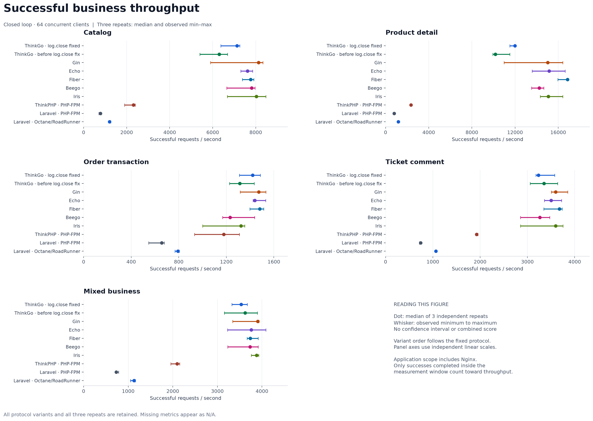
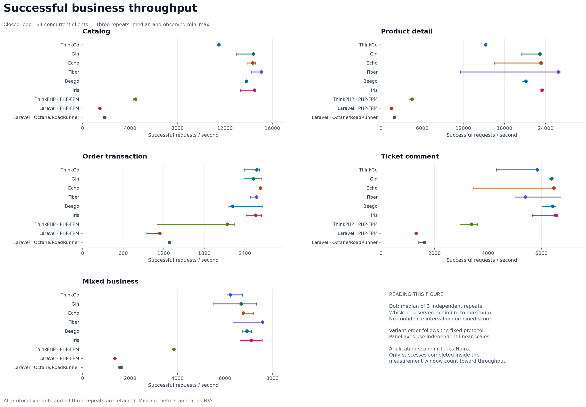
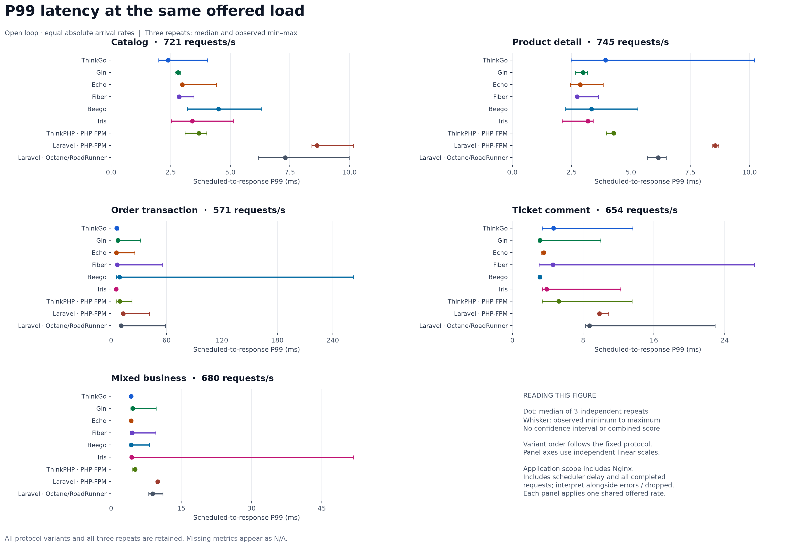

# ThinkGo Framework

`github.com/zhuhanxin0308/thinkgo/v3` 是 ThinkGo 的公共 Go 模块，框架源码位于仓库根目录。业务项目通过 CLI 创建，拥有独立的模块、配置和应用目录。

[安装与创建项目](#安装与创建项目) · [原生多应用](#原生多应用) · [路由安全默认值](#路由安全默认值) · [性能对比](#性能对比) · [完整文档](docs/README.md)

## 安装与创建项目

需要 Go 1.26.10 或该分支更新的安全补丁版本；使用 Go 1.27 分支时至少需要 1.27.3。旧工具链受 [GO-2026-6809](https://pkg.go.dev/vuln/GO-2026-6809) 影响，已有二进制需要使用修复版本重新构建并部署。将 Go 的可执行文件安装目录加入 PATH：

```bash
go install github.com/zhuhanxin0308/thinkgo/v3/cmd/thinkgo@v3.0.3
thinkgo create my-project
cd my-project
go test ./...
thinkgo list
thinkgo build linux/amd64
```

`create` 在当前目录下生成指定项目目录，包含 HTTP 和 CLI 入口、默认 index 应用、配置 JSON、语言包、模板、静态资源及测试。目标必须不存在或为空；隐藏文件和子目录也会使创建被拒绝。进入项目后可用 `thinkgo run` 启动服务，或用 `thinkgo make:app admin` 添加应用。

`go get github.com/zhuhanxin0308/thinkgo/v3@v3.0.3` 用于已有 Go 项目添加依赖；安装 CLI 使用上面的 `go install`。下游项目直接依赖公开版本，不需要克隆框架或添加本地 `replace`。

`build` 将二进制、配置 JSON、语言包、模板和静态资源写入 `dist/<平台>`，再次构建同一平台会覆盖该平台产物。Linux 产物还包含 `Dockerfile` 和 `docker-compose.yml`，可进入产物目录执行 `docker compose up -d --build`。发布包不包含 `.env` 和运行数据，数据库、端口等部署配置应在部署环境核对。

完整用法见[安装](docs/基础/安装.md)、[命令行](docs/命令行/README.md)和[目录结构](docs/基础/目录结构.md)。

## 原生多应用

框架通过编译期 `ApplicationDefinition` 清单运行一个或多个相互隔离的应用。每个应用拥有独立配置叠加、容器、Provider、路由、中间件、运行目录和关闭生命周期；HTTP 宿主按域名、路径映射或显式绑定选择应用。所有已编译应用会在网络监听前完成初始化和路由冻结，任一应用失败都会阻断启动。

```go
package main

import framework "github.com/zhuhanxin0308/thinkgo/v3"

func registerGlobalComponents(*framework.App) error { return nil }
func registerIndexComponents(*framework.App) error  { return nil }
func registerAdminComponents(*framework.App) error  { return nil }

func main() {
    application := framework.NewAppUninitialized(".")
    defer func() {
        if err := application.Close(); err != nil {
            panic(err)
        }
    }()

    err := application.RegisterApplications(
        registerGlobalComponents,
        framework.ApplicationDefinition{Name: "index", Register: registerIndexComponents},
        framework.ApplicationDefinition{Name: "admin", Register: registerAdminComponents},
    )
    if err != nil {
        panic(err)
    }
}
```

业务项目通常由 `service:discover` 生成上述清单，不需要手工维护注册表。项目级 `app.default_app`、`app.app_map`、`app.domain_bind`、`app.deny_app_list` 和 `app.app_express` 决定请求解析；应用目录下的配置不能反向修改宿主监听地址或项目级解析规则。

## 路由安全默认值

ThinkGo 默认关闭自动路由、开启强制路由。`config/route.json` 中的 `url_route_must` 缺省为 `true`，新项目也显式采用该配置：

```json
{"url_route_must": true}
```

控制器注册不等于公开其所有动作；业务入口应按 HTTP 方法显式注册路由。未命中规则时不再按 URL 自动调用控制器动作，没有显式 MISS 等接管时返回 404。强制路由不等于 `route_complete_match`，也不替代认证、授权和 CSRF。

已有项目显式配置的 `url_route_must=false` 或注册期调用 `EnableAutoRoute(true)` 仍是主动启用自动调度，不会被自动重写。采用安全默认策略时，应删除旧的显式 `false` 或改为 `true`，并核对路由加载器。完整行为与边界见[自动路由](docs/路由/自动路由.md)。本节描述当前源码策略，已发布版本以对应版本实现为准。

## 浏览器会话安全

`browser_cookie` 应用默认启用 CSRF 和安全响应头；启用 Session 时也会推导这一 profile。认证成功后使用 `Session.SetAuthenticated` 轮换 ID，再处理持久化结果。生产或预发环境可显式设置 `app.security_strict=true`，检查 Cookie 属性和未知会话 ID 策略。升级时核对 CSRF 密钥、客户端令牌提交和 CSP 所需资源，完整配置见[严格安全检查](docs/security/strict-security.md)和[会话认证轮换](docs/security/session-identity.md)。

## 上传安全默认值

`PutFile` / `PutFileAs` 未提供 `upload_policy` 时默认拒绝保存；处理不可信文件应显式配置允许扩展与嗅探 MIME 的配对及实际字节上限。框架默认 `local` 磁盘在非 Web 的 `runtime/storage`，公开磁盘需显式选择。业务已经校验的可信输入可设置 `trusted_upload: true` 保留旧调用行为，此出口不做类型或大小验证。迁移方法与边界见[上传策略](docs/security/upload-policy.md)。

## 性能对比

### 2026-11-08：日志关闭修复前后同机比较

最新批次完成 **300 个完整审计轮次**：8 个框架、10 种配置、5 个业务场景、闭环与开放两种负载、每组 3 次重复。十种配置包含 ThinkGo 日志关闭修复前和修复后两组，使用相同业务源码、SQL、数据和主机条件。

[本批完整报告与复现](docs/benchmarks/2026-11-08-log-close/REPORT.md) · [原始证据](docs/benchmarks/2026-11-08-log-close/raw/) · [逐轮 CSV](docs/benchmarks/2026-11-08-log-close/charts/rounds.csv) · [汇总 CSV](docs/benchmarks/2026-11-08-log-close/charts/summary.csv)

下表为 **64 并发、30 秒窗口、三次重复的窗口内成功请求/秒中位数**；变化只使用本批修复前后数据计算。

| 场景 | ThinkGo 修复前 RPS | ThinkGo 修复后 RPS | 中位数变化 |
|---|---:|---:|---:|
| 商品目录 | 6,305.400 | 7,127.100 | +13.03% |
| 商品详情 | 10,177.233 | 11,987.233 | +17.78% |
| 事务下单 | 1,313.667 | 1,420.700 | +8.15% |
| 工单评论 | 3,352.467 | 3,235.300 | −3.49% |
| 混合业务 | 3,620.333 | 3,533.567 | −2.40% |



五个场景的应用与 Nginx CPU 成本中位数降低 **3.29%–16.49%**，但吞吐和开放 P99 没有全面改善。修复后 ThinkGo 的目录、详情和混合吞吐中位数仍低于本批其他五种 Go 框架配置。报告保留全部观察范围；三个重复不构成统计显著性或稳定排名。

300 个完整轮次累计成功 **22,065,202** 次，另有 **21 次 HTTP 状态错误、241 次传输错误、14,593 次调度丢弃和 5 条未确认评论提交**，涉及的 6 个异常轮全部保留。恢复归档还包含 **1 次控制器超时、审计与资源证据未收齐的 Beego 工单正式测量尝试**，以及 **5 次测量前未完成尝试**，均在报告中单独披露，不混入三轮汇总。21 轮应用内存和 1 轮应用 CPU 观测不完整，对应组标为 N/A。

本批主机为 Intel Xeon Platinum 8573C，可见 9 个逻辑 CPU，非独占资源。它与下面历史批次的主机不同，不能把跨批数值直接拼接为版本收益。

### 2026-11-07：历史通用业务实测

**2026-11-07 通用业务实测**比较 ThinkGo **v3.0.3**、ThinkPHP、Laravel、Gin、Echo、Fiber、Beego 和 Iris。Laravel 分别采用 PHP-FPM 与 Octane / RoadRunner，共九种运行配置。各实现通过真实 HTTP、PostgreSQL 和 Redis 执行共同业务合同与 SQL；框架、运行时及依赖版本均已锁定。

[完整实测报告与复现步骤](docs/benchmarks/2026-11-07/REPORT.md) · [业务与压测源码](benchmarks/business/) · [原始轮次证据](docs/benchmarks/2026-11-07/raw/) · [测试与覆盖率证据](docs/benchmarks/2026-11-07/validation/test-summary.json)

已完成 **270 轮**正式测量，成功处理 **32,516,790 次已发请求**，另保留 **4 次计划请求的调度丢弃**。270 轮事务审计全部通过，HTTP 状态、传输、语义错误和未确认提交均为零。报告包含 10 组 SVG/PNG 图、逐轮及汇总 CSV，并披露预热中断、恢复与资源采样边界。

下面是固定 **64 并发**、每轮 **30 秒**、三次重复的**窗口内成功请求/秒中位数**。目录为分类首屏读取，详情采用 90% 热键访问轨迹，订单为新建两商品事务，工单为带权限与版本更新的评论写入；混合比例为 40% 目录、30% 详情、20% 下单、10% 工单。完整报告同时保留三轮最小—最大范围，不以这些中位数形成跨业务综合分数。

| 配置 | 商品目录 RPS | 商品详情 RPS | 事务下单 RPS | 工单评论 RPS | 混合业务 RPS |
|---|---:|---:|---:|---:|---:|
| ThinkGo | 11,483.5 | 15,254.9 | 2,575.4 | 5,839.1 | 6,222.6 |
| Gin | 14,389.3 | 23,149.7 | 2,526.4 | 6,382.3 | 6,679.1 |
| Echo | 14,350.8 | 23,291.3 | 2,634.4 | 6,458.4 | 6,764.0 |
| Fiber | 15,044.7 | 25,843.4 | 2,573.1 | 5,395.7 | 7,580.1 |
| Beego | 13,806.4 | 21,117.7 | 2,219.6 | 6,416.4 | 6,920.8 |
| Iris | 14,487.4 | 23,468.9 | 2,561.9 | 6,527.6 | 7,104.6 |
| ThinkPHP-FPM | 4,462.6 | 4,521.7 | 2,139.2 | 3,382.4 | 3,846.3 |
| Laravel-FPM | 1,443.6 | 1,491.4 | 1,142.0 | 1,308.3 | 1,361.6 |
| Laravel-Octane | 1,867.1 | 1,929.6 | 1,282.8 | 1,616.0 | 1,596.2 |



ThinkGo 的目录、详情和混合吞吐中位数低于本次其他五个 Go 配置；订单中位数与多个 Go 配置接近且观察范围重叠。不同场景存在明显波动，应结合完整范围、共同开放负载下的尾延迟、错误和资源成本判断，不能将微小名次差解释为稳定优势。

共同开放到达率下，ThinkGo 的目录、详情、下单、工单和混合 P99 中位数分别为 **2.389、3.925、6.087、4.659、4.251 ms**。目录与混合的中位数在 Go 组较低，但相关观察范围重叠；详情与工单的中位数在 Go 组最高。混合业务应用与 Nginx 的 CPU 成本则在 Go 组最高，闭环为 **0.303 ms/成功请求**，开放为 **0.556 ms/成功请求**。本次结果不支持把 ThinkGo 描述为整体性能领先。



本次环境为 Linux / AMD EPYC 9V74，可见 9 个逻辑 CPU。应用与 Nginx 绑定 CPU 0–2，数据库、负载端和 Redis 另行绑定；亲和性不代表独占核或硬配额。初始业务表与索引约 148.78 MiB，PostgreSQL 缓冲区为 512 MiB；请求走本地 HTTP/1.1 长连接。运行模式、缓存、持久性、资源采样和结果边界见完整报告。

**历史快照单独保留：** [2026-09-24—25 数值表](docs/benchmarks/2026-09-24/RESULTS.md)、[历史测试条件](docs/benchmarks/2026-09-24/METHODOLOGY.md)、[历史来源及图表状态](docs/benchmarks/2026-09-24/SOURCE.md)。该快照对应 ThinkGo v3.0.2 与另一套硬件、业务及 PHP 部署条件，不能与本次数字直接拼接为版本提升比例。

## 发布与安全

v3 使用根标签 `v3.X.Y`，模块路径以 `/v3` 结尾。原有 v1、v2 标签保留；升级时需要同步修改依赖和 import 路径。发布工作流执行双 CGO 测试、Race Detector、逐包 80% 覆盖率、路由 fuzz、真实性能预算、MySQL/PostgreSQL/Redis/MongoDB/Neo4j 真实服务契约、静态与漏洞扫描，并生成 CycloneDX SBOM、SHA-256 校验和和构建 provenance。发布结果以 [GitHub Releases](https://github.com/zhuhanxin0308/thinkgo/releases) 和对应工作流状态为准，维护者流程见 [RELEASING.md](RELEASING.md)。

框架采用 Apache License 2.0，完整条款见本目录的 `LICENSE`。
