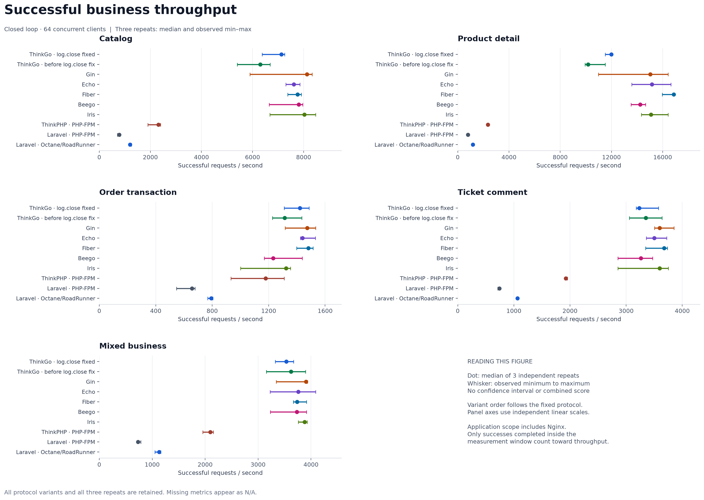
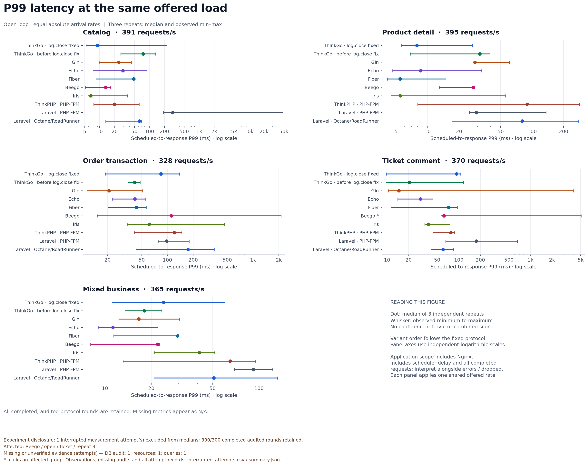
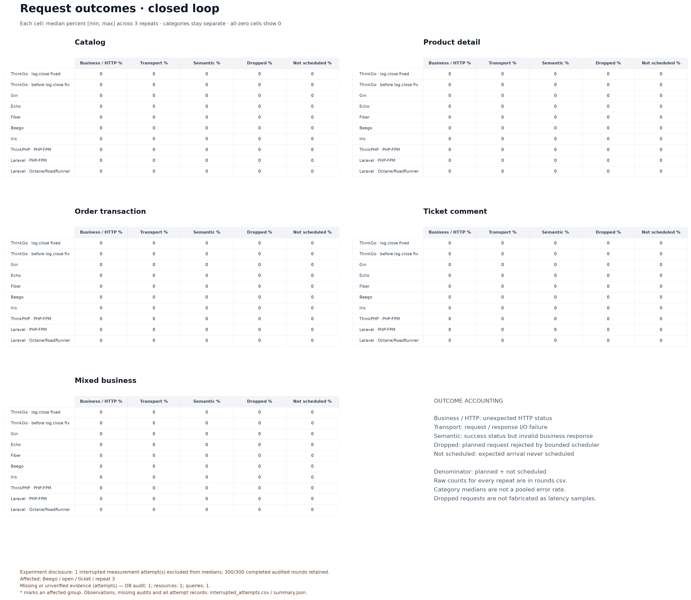
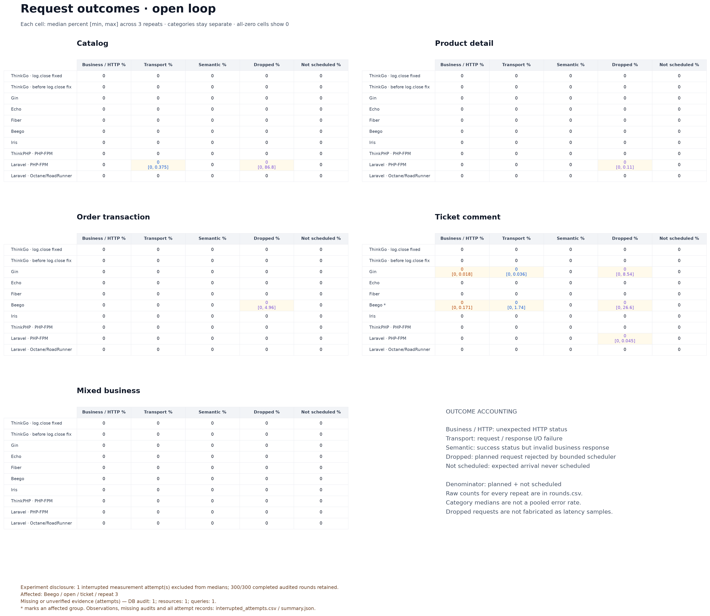
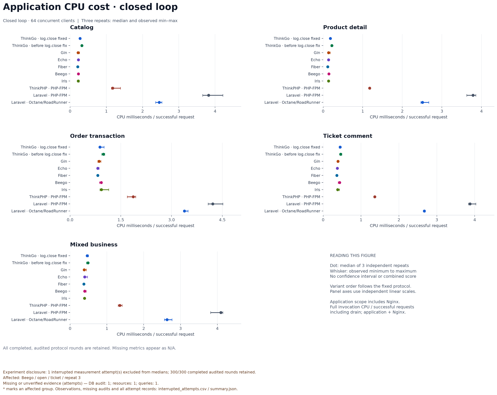
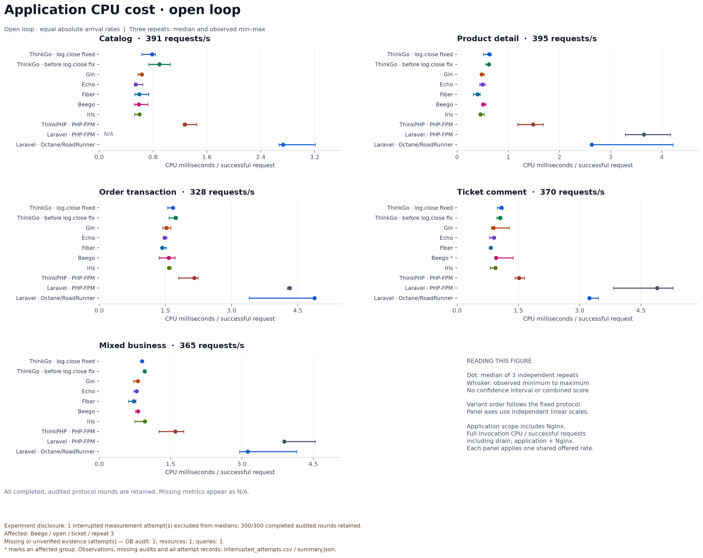
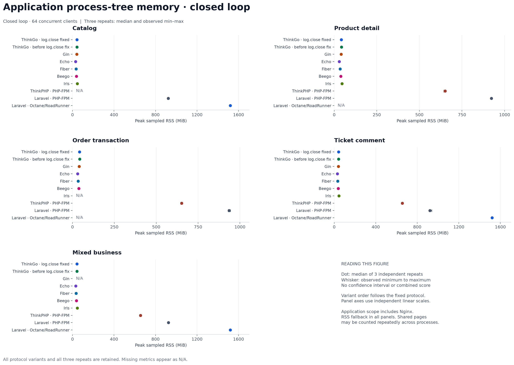
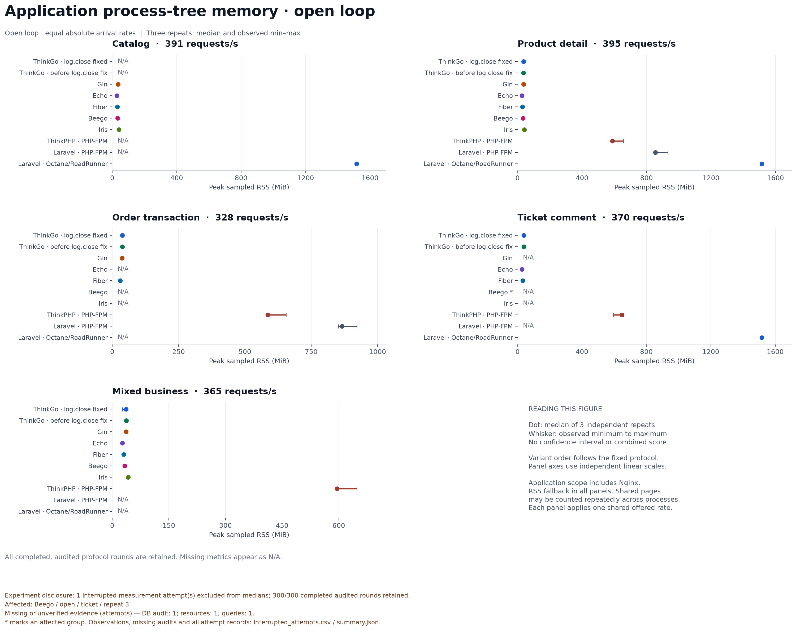
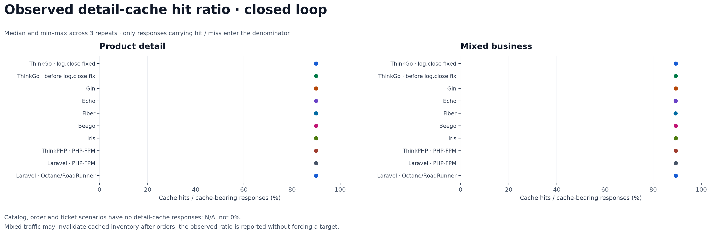
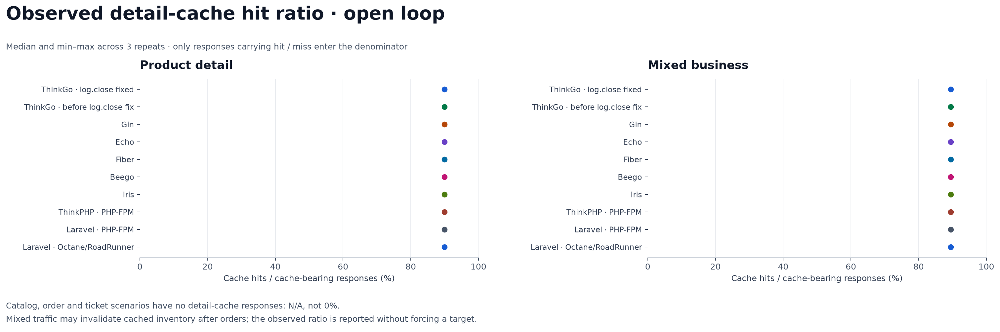

# 2026-11-08 日志关闭修复前后与通用业务性能实测

## 完成范围与结论

本批次完成 **8 个框架、10 种配置、5 个场景、2 种负载模型、每组 3 次重复，共 300 个完整审计轮次**，得到 100 个比较组。十种配置包含 ThinkGo 日志关闭修复前、修复后两组，以及 Gin、Echo、Fiber、Beego、Iris、ThinkPHP-FPM、Laravel-FPM、Laravel-Octane/RoadRunner。[正式索引](raw/index.json)、[冻结协议](raw/contracts/protocol.json)、[机器可读汇总](charts/summary.json)。

正式索引于 **2026-11-08 16:07:05 UTC（北京时间 2026-11-09 00:07:05）**生成，目录日期沿用启动日期。执行跨越 7 次控制会话；归档另保留 **1 次已开始正式负载但证据未收齐的测量尝试、5 次测量前准备或预热未完成的尝试**。共保留 301 份正式负载报告，其中 300 轮形成完整审计证据；不能把完成轮次称为所有测量调用或无中断运行。

ThinkGo 修复后，目录、详情、下单的闭环吞吐中位数分别提高 **13.03%、17.78%、8.15%**；工单和混合场景分别降低 **3.49%、2.40%**。五个闭环场景的应用与 Nginx CPU 成本中位数均降低，观察降幅为 **3.29%–16.49%**。开放 P99 没有一致改善。三个重复只提供中位数及观察范围，不构成统计显著性、稳定排名或生产容量保证。

本报告保留全部六个完整异常轮，以及额外中断尝试的已有观测。完整轮统计以证据完整且审计通过为纳入条件，中断与重试可能产生选择影响，披露本身不能消除这一限制。新旧 ThinkGo 比例只使用本批同机数据；[2026-11-07 的历史 270 轮](../2026-11-07/REPORT.md)来自另一种主机，独立保留。

## 源码身份与比较范围

| 身份 | 实际记录 |
|---|---|
| ThinkGo 修复前 | [`d5460a4ec301e42e0064e686437d405c066b3228`](https://github.com/zhuhanxin0308/thinkgo/commit/d5460a4ec301e42e0064e686437d405c066b3228) |
| 修复后及实验采集源码 | [`1f7d2b5c4459149394ea6754556443264f9e3918`](https://github.com/zhuhanxin0308/thinkgo/commit/1f7d2b5c4459149394ea6754556443264f9e3918) |
| 已合并变更 | [PR #164](https://github.com/zhuhanxin0308/thinkgo/pull/164)包含日志关闭修复；[PR #165](https://github.com/zhuhanxin0308/thinkgo/pull/165)合入比较工具，合并提交为 `75d254f4e59c206acde33c3e7e390aba97c7a456` |
| 采集提交与合并提交的源码 tree | 均为 `fb4939c9edfbc54848e8cdcbce55170a254d2914`；实际构建身份仍以 `1f7d2b5…` 为准 |
| 构建证据 | [manifest.json](raw/manifest.json)中的 `go_build_provenance`、源码与二进制摘要 |

两种 ThinkGo 都标识为 3.0.3，但框架提交不同。两组使用同一业务模块、合同、负载器、构建参数和本次主机；不能仅凭版本号认定代码相同。构建验证检查清洁源码、实际 `vcs.revision`、Go 版本、目标架构及编译设置。正式二进制未启用 race、coverage、ASan 或 MSan；测后统计和图表处理不改变已冻结的二进制与测量。

六种 Go 框架复用共同 Go 业务层，PHP 配置复用共同 PHP 业务层，两种语言使用一致的 SQL、事务步骤、缓存算法和响应合同。框架保留原生路由、中间件、请求绑定、JSON 和生命周期。结果同时包含运行时、驱动、网关与连接行为，不能解释为纯路由器开销，也不代表各框架完整 ORM、模板、队列生态。[业务与适配源码](../../../benchmarks/business/)。

## 300 个完整轮次的请求会计

以下只合计具有完整证据和数据库审计的 300 轮，额外中断测量不在此表。累计请求用于核对完整性，不作为跨场景综合性能得分。[逐轮 CSV](charts/rounds.csv)、[原始轮次](raw/rounds/)。

| 计数 | 闭环 150 轮 | 开放 150 轮 | 合计 |
|---|---:|---:|---:|
| 计划请求 | 20,415,957 | 1,664,100 | 22,080,057 |
| 发出并完成 | 20,415,957 | 1,649,507 | 22,065,464 |
| 最终成功 | 20,415,957 | 1,649,245 | 22,065,202 |
| 发送窗口内成功 | 20,406,408 | 1,648,581 | 22,054,989 |
| 排空期间成功 | 9,549 | 664 | 10,213 |
| HTTP 状态错误 | 0 | 21 | 21 |
| 传输错误 | 0 | 241 | 241 |
| 语义错误 | 0 | 0 | 0 |
| 调度丢弃 dropped | 0 | 14,593 | 14,593 |
| 未调度 not_scheduled | 0 | 0 | 0 |
| 未确认订单提交 | 0 | 0 | 0 |
| 未确认评论提交 | 0 | 5 | 5 |

守恒关系为 `22,080,057 = 22,065,464 + 14,593`，以及 `22,065,464 = 22,065,202 + 21 + 241`。数据库审计通过表示业务不变量成立，不等于所有计划请求成功。两个 ThinkGo 配置的 60 个完整正式轮次均没有上述错误、丢弃和未确认提交；修复前混合场景曾有失败预热，见恢复记录。

## 闭环吞吐与 ThinkGo 同批前后比较

固定并发 64、正式窗口 30 秒。主吞吐是**窗口内成功完成数 / 30 秒**，不加入排空期成功请求。下表为三个完整审计重复的中位数，单位 RPS；全配置最小—最大值保存在图和[汇总 CSV](charts/summary.csv)中。

| 配置 | 商品目录 | 商品详情 | 事务下单 | 工单评论 | 混合业务 |
|---|---:|---:|---:|---:|---:|
| ThinkGo 修复后 | 7,127.100 | 11,987.233 | 1,420.700 | 3,235.300 | 3,533.567 |
| ThinkGo 修复前 | 6,305.400 | 10,177.233 | 1,313.667 | 3,352.467 | 3,620.333 |
| Gin | 8,126.333 | 15,037.100 | 1,473.300 | 3,596.233 | 3,907.933 |
| Echo | 7,618.000 | 15,153.967 | 1,440.233 | 3,499.167 | 3,757.833 |
| Fiber | 7,763.000 | 16,865.767 | 1,480.933 | 3,674.733 | 3,737.300 |
| Beego | 7,810.000 | 14,237.733 | 1,231.933 | 3,261.500 | 3,734.300 |
| Iris | 8,031.600 | 15,078.100 | 1,323.033 | 3,598.833 | 3,877.600 |
| ThinkPHP-FPM | 2,312.267 | 2,363.067 | 1,178.700 | 1,926.300 | 2,097.300 |
| Laravel-FPM | 782.300 | 790.033 | 656.200 | 740.533 | 730.633 |
| Laravel-Octane/RoadRunner | 1,206.900 | 1,181.233 | 792.967 | 1,065.500 | 1,129.933 |



[吞吐 SVG](charts/closed_throughput.svg)。图中点是中位数、线是实际最小—最大范围，不是置信区间；各场景不合并打分。

变化按 `(修复后中位数 / 修复前中位数 − 1) × 100%` 计算，使用原始精度。方括号为完整三轮范围，单位 RPS。

| 场景 | 修复前中位数 [最小–最大] | 修复后中位数 [最小–最大] | 中位数变化 |
|---|---:|---:|---:|
| 商品目录 | 6,305.400 [5,404.133–6,683.433] | 7,127.100 [6,372.200–7,253.100] | +13.03% |
| 商品详情 | 10,177.233 [9,943.433–11,511.867] | 11,987.233 [11,518.867–12,048.433] | +17.78% |
| 事务下单 | 1,313.667 [1,226.200–1,434.133] | 1,420.700 [1,309.367–1,486.867] | +8.15% |
| 工单评论 | 3,352.467 [3,059.767–3,637.700] | 3,235.300 [3,181.267–3,575.200] | −3.49% |
| 混合业务 | 3,620.333 [3,157.567–3,897.300] | 3,533.567 [3,324.267–3,669.200] | −2.40% |

详情修复后最低值比修复前最高值仅高约 7 RPS，其余场景范围重叠。三个样本不能证明总体差异显著。修复后 ThinkGo 的目录、详情和混合吞吐中位数仍低于本批其他五种 Go 框架配置，不能据局部改善宣称整体领先。没有用 profile 进一步分解框架、数据库和宿主调度的贡献。

## 共同开放到达率下的 P99

每个场景取本批十配置闭环吞吐中位数的最小值，再乘 50% 并向下取整；最小值均来自 Laravel-FPM。共同到达率为 **目录 391、详情 395、下单 328、工单 370、混合 365 请求/秒**，同场景所有配置使用相同绝对速率。[到达率](raw/arrival-rates.json)、[校准实现](../../../benchmarks/business/tools/experiment.py)。接近这个速率的成功吞吐不代表各配置最大容量。

主延迟从计划发送时刻到响应正文读取完成，包含负载端排队和调度滞后。P99 使用全部已完成请求；未发送的 dropped 没有延迟样本，单独统计。下表是三个逐轮 P99 的中位数，单位 ms，不是将所有请求合并后计算的 P99。

| 配置 | 商品目录 | 商品详情 | 事务下单 | 工单评论 | 混合业务 |
|---|---:|---:|---:|---:|---:|
| ThinkGo 修复后 | 8.911 | 7.903 | 83.903 | 93.055 | 24.079 |
| ThinkGo 修复前 | 74.815 | 31.551 | 41.471 | 20.383 | 17.999 |
| Gin | 24.191 | 28.351 | 20.719 | 14.647 | 16.591 |
| Echo | 29.263 | 8.567 | 41.599 | 29.263 | 11.255 |
| Fiber | 48.095 | 5.455 | 43.359 | 72.191 | 29.615 |
| Beego | 13.199 | 27.407 | 110.911 | 62.175 | 21.967 |
| Iris | 6.659 | 5.483 | 61.247 | 37.759 | 40.991 |
| ThinkPHP-FPM | 19.839 | 89.471 | 120.127 | 77.375 | 64.895 |
| Laravel-FPM | 294.655 | 29.183 | 97.791 | 175.999 | 91.711 |
| Laravel-Octane/RoadRunner | 62.815 | 80.127 | 174.335 | 60.287 | 50.975 |



[P99 SVG](charts/open_p99.svg)。对数轴使用紧凑数量级标签，`1k` 表示 1,000 ms；刻度位置和慢轮范围不变。Beego 工单另有一次未收齐证据的正式调用，未进入图中三个完整重复；不能仅用图中最大值描述所有尝试。

| ThinkGo 场景 | 修复前 P99 中位数 [最小–最大] ms | 修复后 P99 中位数 [最小–最大] ms |
|---|---:|---:|
| 商品目录 | 74.815 [26.431–130.559] | 8.911 [5.347–225.791] |
| 商品详情 | 31.551 [6.819–39.519] | 7.903 [5.583–26.831] |
| 事务下单 | 41.471 [34.655–47.999] | 83.903 [18.831–137.727] |
| 工单评论 | 20.383 [9.615–115.583] | 93.055 [9.823–104.575] |
| 混合业务 | 17.999 [13.471–23.343] | 24.079 [11.087–59.967] |

目录与详情中位数较低，下单、工单、混合中位数较高；目录修复后最慢一轮达到 225.791 ms。这些结果不支持所有业务尾延迟都改善的结论。

## 失败、丢弃与恢复

### 六个完整异常轮全部保留

未成功比例分母为计划请求数加 `not_scheduled`；本批完整轮后者均为零。HTTP、传输、语义和 dropped 保持独立类别。

| 轮次 | 成功 RPS | P99 ms | HTTP 错误 | 传输错误 | dropped | 全部未成功比例 |
|---|---:|---:|---:|---:|---:|---:|
| [open-ticket-laravel-fpm-3](raw/rounds/open-ticket-laravel-fpm-3/round.json) | 369.767 | 658.943 | 0 | 0 | 5 | 0.045045% |
| [open-detail-laravel-fpm-3](raw/rounds/open-detail-laravel-fpm-3/round.json) | 394.533 | 29.183 | 0 | 0 | 13 | 0.109705% |
| [open-ticket-gin-3](raw/rounds/open-ticket-gin-3/round.json) | 329.800 | 3,964.927 | 2 | 4 | 948 | 8.594595% |
| [open-ticket-beego-3](raw/rounds/open-ticket-beego-3/round.json) | 264.033 | 5,083.135 | 19 | 193 | 2,953 | 28.513514% |
| [open-order-beego-3](raw/rounds/open-order-beego-3/round.json) | 304.267 | 2,123.775 | 0 | 0 | 488 | 4.959350% |
| [open-catalog-laravel-fpm-3](raw/rounds/open-catalog-laravel-fpm-3/round.json) | 49.933 | 47,742.975 | 0 | 44 | 10,186 | 87.212276% |

完整轮的 dropped 共 **14,593**：`inflight_limit=4,380`、`schedule_window_elapsed=10,161`、`dispatch_window_elapsed=52`。各异常组另两轮为零，因此所有组未成功比例中位数仍为零；不能将其描述为“零错误”。错误图显示中位数及完整范围。





[闭环错误 SVG](charts/errors_closed.svg) · [开放错误 SVG](charts/errors_open.svg)。

`open-ticket-beego-3` 的[数据库审计](raw/rounds/open-ticket-beego-3/audit.json)记录 **5 条未确认评论**。确认的 8,935 条评论包含 1,000 条预热成功和 7,935 条正式成功；数据库另有 5 条提交未获客户端成功确认，不加入成功吞吐。其余完整轮没有未确认提交；额外中断尝试的未确认写入未知。

### 已开始正式负载但未完成证据链的 Beego 尝试

[open-ticket-beego-3-1794153609264585434](raw/incomplete/open-ticket-beego-3-1794153609264585434/)保留正式 `load.json.gz` 和控制台，但没有 `round.json`、`audit.json`、`resources.json.gz`、`queries.json.gz`。负载报告与协议身份一致，计数、逐秒及 HDR 守恒校验通过。

| 已有负载观测 | 数值 |
|---|---:|
| 计划请求 | 11,100 |
| 发出并完成 | 4,238 |
| 成功，且在窗口内完成 | 3,982 |
| HTTP / 传输 / 语义错误 | 0 / 256 / 0 |
| dropped | 6,862 |
| dropped 分类 | `inflight_limit=799`；`schedule_window_elapsed=6,063` |
| 全部未成功比例 | 64.126126% |
| 窗口成功 RPS | 132.733333 |
| 全部已完成请求 P99 | 107,741.183 ms |
| 完整负载调用耗时 / 排空时间 | 118.568129 / 88.568129 秒 |

[第六会话控制台](raw/runtime-session-06-console.log)明确记录 `subprocess.TimeoutExpired`，控制器等待预算是 65 秒。可确认控制器等待负载进程超时，但不能仅据此锁定框架、数据库或宿主的根因。负载报告 `canceled=false` 不表示整个轮次成功收尾；归档目录后缀是恢复归档时间，不是失败时刻。

该尝试数据库不变量、未确认写入、CPU 和内存均**未知**。它的观测单独保留在[中断尝试 CSV](charts/interrupted_attempts.csv)，不加入 300 个完整轮次的任何中位数、极值和错误合计。Beego 开放工单实际有 4 次留存正式调用、3 次完整审计结果；后续同编号完整轮仍保留 19 次 HTTP 错误、193 次传输错误和 2,953 次 dropped，并没有被替换为零错误结果。

若仅合计已保存的 **301 份正式负载报告**，客户端记录为 **22,069,184 次成功、21 次 HTTP 错误、497 次传输错误、21,455 次 dropped**。这不是 301 个审计通过轮次，也不包含失败预热和初始缓存预热调用，不用作综合性能得分。负载报告原始 SHA-256 为 `35661eb72d052a3d61e157aca6c2426c219337b5b7f63cdbb279c549df60834c`。

### 五次正式计时前未完成尝试

| 场景与配置 | 已保留观测 | 中断阶段及证据 |
|---|---|---|
| Iris 闭环详情第 1 重复 | 1,000 计划；999 成功；1 dropped | 负载预热未全部成功；[会话 01](raw/runtime-session-01-console.log) |
| ThinkGo 修复前闭环混合第 1 重复 | 1,000 计划；992 成功；8 dropped | 负载预热未全部成功；[会话 02](raw/runtime-session-02-cumulative-console.log) |
| Octane 开放详情第 3 重复，第一次 | 仅合同快照，请求计数未知 | 初始缓存预热读响应超时；[会话 03](raw/runtime-session-03-console.log) |
| Octane 开放详情第 3 重复，第二次 | 仅合同快照，请求计数未知 | 初始缓存预热读响应超时；[会话 04](raw/runtime-session-04-console.log) |
| Fiber 开放下单第 3 重复 | 1,000 计划；981 成功；16 传输错误；3 dropped | 负载预热未全部成功；[会话 05](raw/runtime-session-05-console.log) |

这些观测属于准备或预热，不混入 30 秒正式结果。两次 Octane 的计数未知，不能补零。会话 02 控制台累积包含会话 01，重复日志不能重复计为尝试。[全部恢复归档](raw/incomplete/)。

### 最后一轮的归因边界

Laravel-FPM 目录第三轮计划 11,730 次，发出 1,544 次、成功 1,500 次，其中窗口内成功 1,498 次；44 次传输错误和 10,186 次 dropped 合计 **10,230 次未成功**，不能将该合计写成 dropped。该轮调度滞后 P99 为 **47,382.527 ms**，HTTP duration P99 为 **47,742.975 ms**，并记录 91 个采样周期跳过、应用内存缺样 92 次、三个已观察进程消失、应用 CPU 不完整。[负载报告](raw/rounds/open-catalog-laravel-fpm-3/load.json.gz)、[资源证据](raw/rounds/open-catalog-laravel-fpm-3/resources.json.gz)。

不能把整个 47.7 秒 P99 直接归因于 Laravel 请求处理，也不能确定具体外部争用或进程退出原因。不同分布的 P99 不能相减来量化原因贡献。该完整审计轮仍保留。

## CPU、内存和缓存

CPU 成本定义为 **应用与 Nginx 进程树 CPU 秒 × 1,000 / 含排空期的全部成功请求数**，覆盖完整负载调用。它不是单请求墙钟延迟，不含 PostgreSQL、Redis、负载器和控制器。[资源实现](../../../benchmarks/business/tools/resources.py)、[逐轮值](charts/rounds.csv)。

| ThinkGo 场景 | 修复前闭环 CPU ms/成功请求 | 修复后闭环 CPU ms/成功请求 | 中位数降低 |
|---|---:|---:|---:|
| 商品目录 | 0.325327 | 0.275435 | 15.34% |
| 商品详情 | 0.218579 | 0.182536 | 16.49% |
| 事务下单 | 0.982672 | 0.880233 | 10.42% |
| 工单评论 | 0.462450 | 0.447216 | 3.29% |
| 混合业务 | 0.487513 | 0.463683 | 4.89% |





[闭环 CPU SVG](charts/cpu_closed.svg) · [开放 CPU SVG](charts/cpu_open.svg)。五个中位数均下降，部分观察范围仍重叠，不保证其他负载和部署取得同样比例。

300 个完整审计轮次中，**21 轮应用内存不完整，导致 19 组内存汇总为 N/A；1 轮应用 CPU 不完整，导致开放目录 Laravel-FPM 组 CPU 为 N/A**。一组任一重复缺失时，对应指标不使用另两轮重新计算，也不填零。数据库审计完整不等于资源遥测完整。

内存图统一采用 **RSS**，因为并非所有比较轮都具有完整 PSS。逐进程 RSS 相加可能重复计算共享页，尤其是 PHP 多 worker 与 OPcache；不能直接解释为物理内存倍数。峰值是每 0.5 秒采样观察到的峰值，不保证捕获采样间的瞬时峰值，也不包含测量前启动峰值。





[闭环内存 SVG](charts/memory_closed.svg) · [开放内存 SVG](charts/memory_open.svg)。

详情请求轨迹为 90% 热键和 10% 冷键；混合业务中的订单会使缓存失效。实际命中率按 `cache_hits / (cache_hits + cache_misses)` 计算，只使用带有缓存状态的响应，不把缺失状态虚构为 miss，也不强行改成 90%。目录、下单、工单没有详情缓存观测，该指标不适用。





[闭环缓存 SVG](charts/cache_closed.svg) · [开放缓存 SVG](charts/cache_open.svg)。

## 运行条件与业务合同

| 条件 | 本批配置 |
|---|---|
| 主机可见信息 | Linux 6.18.57，x86_64，Intel Xeon Platinum 8573C，可见 CPU 0–8，`MemTotal=10,206,468 kB` |
| 独占与配额 | `exclusive_cpu_allocation=false`；cgroup CPU quota 不可读取；亲和性不等于独占或硬配额 |
| CPU 亲和性 | 应用和 Nginx：0–2；PostgreSQL：3–5；负载：6–7；Redis 与控制采样：8 |
| 负载参数 | 预热 10 秒、100 请求/秒；正式 30 秒；闭环 64 并发；开放最大在途 256；请求超时 5 秒 |
| 网关 | Nginx 1 worker，本地 HTTP/1.1 keep-alive；Go/Octane 用 HTTP 上游，FPM 用 FastCGI；不含公网 RTT 和 TLS |
| 数据库 | PostgreSQL 18.6，`shared_buffers=512MB`、`work_mem=8MB`、`max_connections=96`；持久性开关开启 |
| 应用数据库预算 | Go 连接池 24；FPM、Octane 各 24 worker；连接和进程调度语义仍不同 |
| Redis | 8.10.3，512mb，`noeviction`，无 RDB/AOF，用作缓存 |
| 运行时 | Go 1.27.3、PHP 8.5.12、Nginx 1.30.6、Python 3.12.14 |

来源为 [manifest](raw/manifest.json)、[数据库实际设置](raw/database-settings.json)、[协议](raw/contracts/protocol.json)和[启动实现](../../../benchmarks/business/tools/native.py)。宿主不是独占资源，未全面观测其他后台活动。

框架冻结版本为：ThinkGo 3.0.3（前述两个提交）、Gin 1.12.0、Echo 5.4.4、Fiber 3.6.1、Beego 2.3.10、Iris 12.2.11、ThinkPHP 8.1.4、Laravel 13.40.0；常驻模式为 Octane 2.23.0 / RoadRunner 3.0.1。依赖没有在实验中途升级，这些是实际版本快照，不是持续的最新版声明。[Go 模块锁](../../../benchmarks/business/go/go.mod)、[运行依赖来源](../../../benchmarks/business/contracts/runtime-sources.json)。

数据为确定性合成业务数据：4 个租户、4,000 个用户、128 个分类、100,000 个商品、300,000 条规格、20,000 个工单、60,000 条初始评论，请求真实经过 HTTP、PostgreSQL 和 Redis。目录读取分类首屏；详情读取商品和规格；下单执行库存、订单明细及审计事务；评论处理权限、版本和评论更新。混合权重为 **40% 目录、30% 详情、20% 下单、10% 工单**。响应只返回业务合同使用的字段。[数据合同](raw/contracts/dataset.json)、[SQL](raw/contracts/queries.json)、[种子计数](raw/seed-counts.json)、[十配置外部验收](raw/verification/)。

schema、索引、SQL 与算法保持冻结，本次没有修改数据库设计。目录部分复合索引、主键点查、订单幂等约束、评论索引和写入约束均参与执行；不能将主键点查解释为固定一次磁盘 I/O，也不将基础数据可容纳于缓冲区的实验描述为超内存数据库测试。[schema](raw/contracts/schema.sql)、[准备阶段执行计划](raw/query-plans.json)、[表与索引体积](raw/schema-metrics.json)。

## 证据校验与复现

每个完整轮次保存负载报告、资源样本、SQL 统计、数据库审计及摘要清单；PHP 轮另存实际合同快照。运行日志、Nginx 日志、Octane 诊断和全部恢复归档一起保留。`progress.jsonl` 的恢复复用事件会重复记录已有轮次，不能把事件数量当成实测次数；唯一轮次目录与最终索引定义正式矩阵。

| 原始入口 | SHA-256 |
|---|---|
| [manifest.json](raw/manifest.json) | `8200e6f4f22dda0920622effaa52542630e004bbaabe5ab14cc57d63912f2123` |
| [index.json](raw/index.json) | `61da976e6d35f59873aa0d696b50d18d03159c33572cced1c4eba47875d7cc64` |
| [arrival-rates.json](raw/arrival-rates.json) | `5dc765bbf41cee70fda1db68739d9aca164f5ecfd1e0e536cb65c4b53b6001c1` |

发布前对全部 300 轮执行了矩阵完整性、索引与逐轮一致性、文件摘要、请求与 HDR 守恒、业务审计重算、构建来源和开放到达率校准验证。额外尝试单独核验已有负载报告，缺失审计和资源保持未知。没有为了改善排名重跑或删除完整慢轮。

测后渲染器增加了中断尝试独立会计、受影响组标记、逐图披露及完整证据边界校验，并修正宽动态范围 P99 刻度文字重叠。实际文字边框回归先在旧格式下失败，再验证新格式保留慢轮、小值可读性和全部统计。最终渲染模块 **29 项测试全部通过、0 跳过**；语句覆盖 **448/459，97.60%**，分支覆盖 **110/118，93.22%**。[测试日志](validation/render-tests.log)、[原始覆盖数据](validation/render-coverage.json)。这些覆盖率的统计范围是渲染模块。

最终完整渲染得到 100 组结果。刻度显示修正前后，全部分组指标和三份 CSV 字节均不变，PNG 中仅 P99 图改变；JSON 只更新渲染来源信息。最终渲染器 SHA-256 为 `2da08b72d44876f36b162d75eff9f202f8b9122d29f1b8194001c10dc84f81fc`。已检查正式图表的刻度、慢轮范围、N/A 和中断披露。

使用安装了[锁定 Python 依赖](../../../benchmarks/business/tools/requirements.txt)的解释器，从仓库根目录重新验证并渲染到一个不存在的输出目录：

```bash
python3 benchmarks/business/tools/render.py \
  --input docs/benchmarks/2026-11-08-log-close/raw \
  --output /tmp/thinkgo-log-close-charts
```

输出保留逐轮与汇总 CSV、JSON，以及 10 张 PNG 和 10 张 SVG。重新渲染是验证封存证据和展示，不是新的性能测量。若重新采集，应使用[执行源码](../../../benchmarks/business/)、冻结合同、真实前后源码和构建参数，在新的结果目录独立完成矩阵；不能覆盖本批 raw、择优替换某个重复，或拼接不同主机轮次来计算修复收益。
